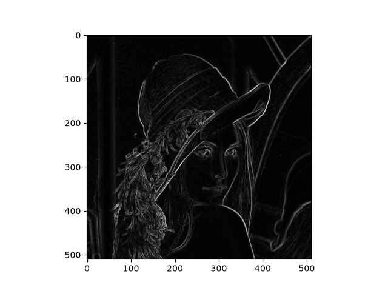

# SV Sobel component
A SystemVerilog design for a component that takes an images as RGB pixel stream and outputs its (aproximate) sobel gradient.

### Usage:
The generate_mem.py script can be used to generate the necesary memory needed by the stestbench to process and verify an image
```sh
python generate_mem.py --image image.png --out-dir vector/image
```
If no arguments are provided the default is a 4x4 dummy image placed in vector/dummy

Once the memory is generated the a top level test bench needs to be made instantiating the soble_test_runner.sv with the desired parameters.

Example:
```
module image_tb_top;
sobel_test_runner #(
.DEFAULT_WIDTH(512),
.DEFAULT_HEIGHT(512),
.DEFAULT_IMG_FILE("vectors/image/rgb_image.mem"),
.DEFAULT_EXPECTED_FILE("vectors/image/expected_gradient.mem"),
.DEFAULT_OUTPUT_FILE("actual_gradients.mem")
) test_runner ();
endmodule
```

The simulation can then be run using:
```sh
vlog -sv rtl/rgb_to_gray.sv rtl/window.sv rtl/sobel.sv rtl/top.sv tb/sobel_test_runner.sv tb/image_tb_top.sv
vsim -c image_tb_top -do "run -all; quit -f"
```

The result will be stored in ```actual gradients.mem```, witch can be converted into an image using the mem_to_image.py script

